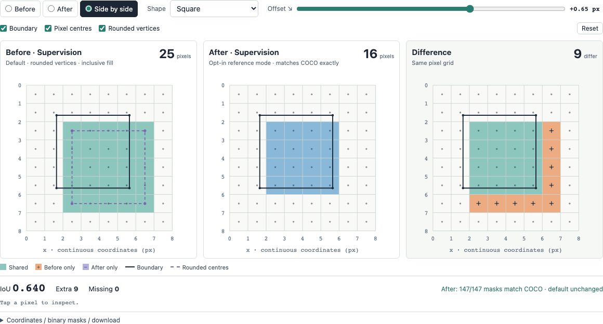

# Supervision polygon check

[Interactive before/after demo](https://christophdeil.com/supervision-poly-check/) · [Proposed Supervision change](https://github.com/cdeil/supervision/pull/1)

Identical COCO polygons produce different masks in Supervision and pycocotools. A square spanning `(1,1)` to `(5,5)` gives 25 pixels with inclusive integer fill and 16 with COCO's reference convention. The proposal adds an opt-in `mask_rasterizer="pycocotools"` to the COCO loader, preserving current defaults.



## Reproduce

Install [uv](https://docs.astral.sh/uv/getting-started/installation/), then:

```bash
git clone https://github.com/cdeil/supervision-poly-check.git
cd supervision-poly-check
uv run --locked --extra before python reproduce.py --output results/baseline.json
uv run --locked --extra after python reproduce.py --baseline results/baseline.json --output site/masks.json
uv run --locked --extra before pytest -q
uv run --locked --extra before python -m http.server 8000 --directory site
```

Open `http://localhost:8000`. Both Supervision versions are defined in `pyproject.toml`: the `before` extra uses release 0.30.9; `after` uses the patched fork at an immutable Git commit. Common package versions are pinned there too, and `uv.lock` locks the full dependency graph. uv selects Python 3.14 and switches the Supervision package when selecting either extra.

Seven synthetic shapes × 21 offsets give 147 cases. The generator uses the actual `DetectionDataset.from_coco` loader, verifies unchanged defaults, checks every proposed mask against pycocotools, and checks RLE parity in both modes. The browser displays the measured arrays in `site/masks.json`.

GitHub Actions regenerates the data on Linux and checks it against the committed results before deploying to GitHub Pages. The page defaults to +0.65 px, pixel centres and rounded vertices. Select **After** or **Side by side** to compare. No external dataset or credentials are needed.
